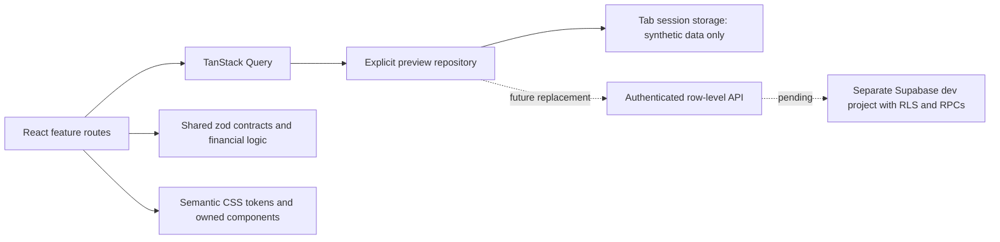

# Architecture

**Authentication stage, 5 November 2026** - `data/auth.tsx` owns the singleton Supabase client, Auth events, server identity verification and TanStack member query. `packages/shared/src/auth.ts` owns validation and frontend workspace rules. `AuthGate` wraps application routes; no protected shell renders before identity/member verification. `Access` provides real forms while `PreviewAccess` retains the explicitly configured synthetic chooser. `VITE_APP_MODE=authenticated` is the default; missing configuration fails closed. The browser API key is validated as publishable/anon, and Vite refuses server keys before bundling. Supabase is separated into a vendor chunk. Existing repositories still handle synthetic business records only; none were replaced with live finance/operations tables. See START-HERE for the setup contract and limitations.

The connected feature layer derives directories, notice/document views and review queues from the same workspace items. Shared integration schemas add synthetic media descriptors, typed local actor messages and per-thread read cursors with defaults for older compatible tab data. A guarded content-publication operation accepts supported locally reviewed content only; it is not authentication/authorization. Operations simulations use the same adapter. `/coverage` maps frozen metadata to current route entry points. See [[Connected workflows]].

**Observed** — React 19 and TypeScript render an owned UI library and feature routes. React Router owns navigation. TanStack Query owns asynchronous repository reads/mutations. CSS Modules and semantic tokens own styling. Zod contracts and pure calculations live in `packages/shared`.

**Observed** — Production builds split feature routes. PWA caching is limited to public app assets; no records endpoint has a runtime cache rule.

**Risk** — The demo uses a single browser-state envelope for convenience. It is not a backend design and must never become the production storage model. See [[Data model]] and [[Security]].

**Observed** — The extended preview adds a separate typed workspace adapter (`data/workspace.ts`) and shared preview schemas (`packages/shared/src/workspace.ts`). It stores synthetic applications, content drafts, service interests, expenses and their local timelines under a separate session key. Existing resident data and extended workspace data can be reset independently. These are browser demonstration adapters, not normalized production tables or API contracts for real authority.

**Observed** — `/office`, `/security`, `/driver` and `/board` select visual workspace navigation by route. `/sign-in` is an explicit chooser, `/register` saves synthetic applications, `/recover` reports its missing provider and `/sign-out` clears in-memory Query state. None verifies identity or grants permissions. Developer diagnostics are allowlisted metadata only; no environment secret reader or remote maintenance client exists.
