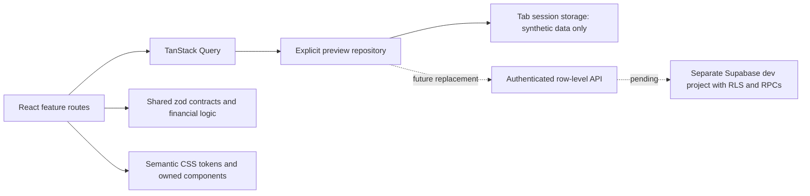

# Architecture

**Authentication stage, 5 November 2026** - `data/auth.tsx` owns the singleton Supabase client, Auth events, server identity verification and TanStack member query. `packages/shared/src/auth.ts` owns validation and frontend workspace rules. `AuthGate` wraps application routes; no protected shell renders before identity/member verification. `Access` provides real forms while `PreviewAccess` retains the explicitly configured synthetic chooser. `VITE_APP_MODE=authenticated` is the default; missing configuration fails closed. The browser API key is validated as publishable/anon, and Vite refuses server keys before bundling. Supabase is separated into a vendor chunk. Existing repositories still handle synthetic business records only; none were replaced with live finance/operations tables. See START-HERE for the setup contract and limitations.

The connected feature layer derives directories, notice/document views and review queues from the same workspace items. Shared integration schemas add synthetic media descriptors, typed local actor messages and per-thread read cursors with defaults for older compatible tab data. A guarded content-publication operation accepts supported locally reviewed content only; it is not authentication/authorization. Operations simulations use the same adapter. `/coverage` maps frozen metadata to current route entry points. See [[Connected workflows]].

**Observed** — React 19 and TypeScript render an owned UI library and feature routes. React Router owns navigation. TanStack Query owns asynchronous repository reads/mutations. CSS Modules and semantic tokens own styling. Zod contracts and pure calculations live in `packages/shared`.

**Observed** — Production builds split feature routes. PWA caching is limited to public app assets; no records endpoint has a runtime cache rule.

**Risk** — The demo uses a single browser-state envelope for convenience. It is not a backend design and must never become the production storage model. See [[Data model]] and [[Security]].

**Observed** — The extended preview adds a separate typed workspace adapter (`data/workspace.ts`) and shared preview schemas (`packages/shared/src/workspace.ts`). It stores synthetic applications, content drafts, service interests, expenses and their local timelines under a separate session key. Existing resident data and extended workspace data can be reset independently. These are browser demonstration adapters, not normalized production tables or API contracts for real authority.

**Observed** — `/office`, `/security`, `/driver` and `/board` select visual workspace navigation by route. `/sign-in` is an explicit chooser, `/register` saves synthetic applications, `/recover` reports its missing provider and `/sign-out` clears in-memory Query state. None verifies identity or grants permissions. Developer diagnostics are allowlisted metadata only; no environment secret reader or remote maintenance client exists.

### 13 November 2026 - public/protected loading boundary

App.tsx is now the small entry router, preserving theme initialization and choosing PublicAccess or ProtectedApplication through lazy imports. PublicAccess retains the public Access/Exit/PWA behavior plus title/scroll reset. ProtectedApplication preserves the existing real/developer/target/synthetic gates and workspace redirect. AppShell.tsx contains the unchanged signed-in shell/helper bodies; resident Home and preview modules load on their relevant paths. Public registration and synthetic access are also split within Access. This is a code-loading boundary, not an authentication boundary; server authorization is unchanged.

See [Performance first pass](../PERFORMANCE-FIRST-PASS.md). Financial and authority-related queries retain previous freshness. Short presentation caches and current/next announcement preloading reduce redundant work. Media URLs retain 60-second validity and are not persisted; authorization/signing remain coupled on renewal. Source/TypeScript/build checks passed; browser/device acceptance remains with the owner.

### 13 November 2026 - approved workspaces and notification subjects

Added a real workspace chooser at /workspaces for accounts with multiple server-assigned, permitted workspaces, plus a resident workspace selector on mobile/desktop. A single workspace still opens directly. This changes navigation only; public registration, assigned roles and server authorization remain unchanged. Connected My account now emphasizes the member name, household role and address. Customer help and shared error feedback use plain language; explicit synthetic previews retain their disclosures.

Prepared migration 070 to resolve existing/future notification destinations during authorized reads and open exact owned booking/pass/submission/application records through the existing dashboards. Helpdesk uses exact UUID filtering with existing owner/RLS checks. Subject reads do not depend on the first dashboard page; unread state changes only after a linked subject loads. Unavailable destinations show a fallback. New booking choices exclude legacy Clubhouse; prepared 068 remains responsible for connected pool configuration/history preservation. No new booking-limit policy was introduced.

See [Account workspaces and notification destinations](../ACCOUNT-WORKSPACES-NOTIFICATIONS.md). Source-reviewed SQL is prepared only; the owner applies it and performs browser acceptance. Earlier loading optimization and CORS work are preserved.

### 13 November 2026 - account charge details without empty disclosures

Connected My account no longer mounts the two charge disclosures on the overview. Verified invoice/amenity-charge counts independently control View HOA bills and View amenity charges links. Counts, rather than unpaid amounts, preserve access to fully paid history; an empty category adds no link or empty disclosure. Existing overview loading/error/balance states remain.

The existing /account/* route serves /account/bills and /account/amenity-charges as separate details screens using MonthlyHoaCharges and AmenityCharges. The shared mobile Back control returns through history with /account as the direct-link fallback. Existing Finance permissions, paging, payment/allocation/refund guidance and server reads remain. Charge components mount only on their details route. No SQL or financial calculation changes.

### 13 November 2026 - one mobile page-level Back control

CustomerBack now identifies the header return control with data-customer-back. At the same portrait/landscape breakpoints where that control is visible, the resident shell suppresses body-level .back-link and data-page-back returns. This applies to existing customer profile/help/community/directory/statement links as well as the shared BackLink, lot-profile return and service-page wrapper; empty wrapper spacing is removed too. Desktop/staff navigation and same-module controls without a header Back retain their existing actions. Unavailable-record recovery links remain available.

Directly opened nested lot pages now fall back to their lot list (/account/lots or /more/lots); standalone feature pages fall back to /explore. History-based Back behavior, authentication, permissions and data operations remain unchanged. No database migration is required.

### 13 November 2026 - verified customer property states

Connected customer property lists now use bfe_my_linked_properties directly, sharing the own-link cache with the account address. They do not mount the registry search/list query. Confirmed links produce property cards with detail links and an optional request to link another property. An empty successful link check produces Request a lot link; pending/failed checks never become an unlinked state. Office registry searching and labelled synthetic lists retain their existing paths.

The visible customer list opts into 30-second own-link polling so Office changes can appear without a full-page refresh; other hook consumers retain their previous non-polling default, and member preview polling is disabled. Reads remain server-filtered to current approved links. Link requests still use the existing protected claim workflow, with Office verification required. Property-list errors and other registry reads now describe failed loading rather than an uncertain save. The Properties tab owns link retry feedback; the account header keeps its retry only on the Payments tab to avoid duplicate retry controls.

### 13 November 2026 - numeric My account balances

The connected My account card now formats the confirmed total_balance_centavos and hoa_balance_centavos even when invoice/amenity counts are zero. A confirmed zero appears as PHP 0.00 instead of No bills yet. The no-posted-charges explanation remains beside the number; no unpaid months or charges are inferred from the recurring rate. Missing/error/loading and reconciliation-review states remain non-numeric, and unavailable water dues remain explicitly unavailable. The calculation, posted-charge scope and backend are unchanged.

### 13 November 2026 - unified Livelihood views

Marketplace retains one Livelihood heading and persistent Browse / My listings / My applications view controls. URL-based view/category selection supports browser history and direct management links. The six listing categories remain available; listing creation uses the existing permitted postable modules through the shared desktop action/mobile + in every view. Management views request only the unfiltered first feed page for current posting permissions, with no feed background polling there. Read-only member previews remain Browse-only.

Embedded LiveFeature hides the redundant category intro and create/navigation actions while preserving own listing records, edits, withdrawals and existing authorization. Embedded ParticipationDesk shows applications/status/history without the standalone workshop intro, open-activities section or generic Apply button. The selected workshop/booth event detail starts the existing protected application form; closed or inaccessible activities show feedback. Application type changes clear stale event/record targets. Standalone and Office participation layouts retain their existing headings/actions. No SQL or approval-policy changes.

### 13 November 2026 - owner-designed Account cards

Applied the supplied Account layout using existing CSS tokens and solid surfaces: Account page title, initial avatar, member name/role badge, linked-address row, large numeric total and stacked icon/amount breakdown. Empty confirmed billing uses No posted charges, never Nothing due; water remains Unavailable and reconciliation/loading/error states remain explicit. No repeated total at the bottom. Properties/Payments use pill navigation. Existing verified-charge detail links and property-state handling remain.

PayDues now presents its monthly rate separately from balance with a visible rate warning, one inline copy-reference control and the existing owner-supplied Buyani external handoff. Reference format, suffix matching reminder, authorization, billing calculations and payment confirmation remain unchanged. The component is shared by account/lot/preview surfaces; no real payment confirmation is inferred from opening the external destination.

### 13 November 2026 - compact account properties and receipts

Customer property cards now show the confirmed physical lot ID and phase/block/lot plus the server-returned relationship (owner displayed as Homeowner, renter as Renter, household as Household member). Compact home-icon rows and a rounded Link another property action match the supplied Account design. Office registry cards and link approval rules are unchanged.

Account receipt rows now use a receipt icon, number and combined lot/date metadata, with the recorded amount aligned right; the previous desktop table headings are removed. Date filters remain side by side from 360px, stacking below that width; narrow receipt amounts move beneath the details. Existing receipt access, warning, error/retry/empty states, date filtering and paging remain unchanged. No sample receipts, amounts or relationships are inserted.

### 13 November 2026 - stable account section switching

The shell now skips its scroll-to-top, whole-page entry animation and main-focus reset only for resident navigation between /account, /account/lots and /account/payments. Existing scroll handling remains for individual lots, charge details and other modules. Account section links request preventScrollReset, and the content wrapper reserves viewport-relative height to limit upward clamping when a short/loading list replaces a longer section. Route URLs, permissions and browser history remain intact.

### 13 November 2026 - responsive Livelihood Browse cards

Reused Marketplace and its existing feed without changing queries, RPCs, route definitions or schemas. Browse now uses repeat(auto-fill, minmax(160px, 1fr)) with a 10px gap, without fixed column-count breakpoints. Mobile page gutters are reduced by 6px on each side within the existing 16px shell padding, leaving space for two minimum tracks at 360px. Empty tracks keep a single listing from spanning the grid. Card links use the existing listing query parameter and preserve other filters; the same details modal handles the destination.

Cards use square lazy signed covers, two-line title clamping, tabular bold prices and category/condition pills. Focus outlines and hover borders use tokens. Cover-only loading/missing/error states show a neutral image-icon placeholder; image load failures use that fallback instead of a broken image. Signed URL authorization, lifetime checks, queries and eager announcement preloading remain unchanged. No synthetic listing records were inserted.

### 13 November 2026 - compact Livelihood controls and search

Removed the empty header-actions flex row from layout, tightened mobile heading/view/category/filter/result spacing and card padding, and explicitly uses body typography for Livelihood/results headings. View controls use pill shapes. Marketplace search separates one rounded icon/input field from its submit button; native inner input borders/padding/focus shadows are reset and the field supplies one visible focus outline. CustomerSearch similarly resets inner focus decoration and displays its placeholder on mobile Search instead of a blank field. Controls retain 48px targets; card square aspect ratio, auto-fill grid, routing and data behavior remain.

### 13 November 2026 - Home hotlines and reusable pass sheet

Added HomeHotlines below resident announcements, gated by the existing Hotlines destination permission. Three horizontal scroll-snap cards consume emergencyContacts, communityContacts and utilityContacts from the existing public contact module. Each renders all named contacts and labelled number lines via hotlineTelephone; no number, staff name or email is added or changed. See all hotlines uses the existing route. Each category body has bounded vertical scrolling and keyboard access; theme tokens style surfaces/body text with contrasting fixed category header accents.

Sheet wraps the existing native Modal rather than duplicating focus trapping, background scroll locking, focus restoration, Escape/scrim handling, dirty-form protection or keyboard viewport sizing. Sheet CSS bottom-anchors the panel, exposes a decorative handle and keeps header/actions outside the scrolling body. Request a pass uses Sheet through BookingComposerFrame; its existing fields, constraints, handler, RPC arguments and route remain. The action row is lifted unchanged to the footer and references the original form through useId and native form attributes. Inline resident amenity booking and Office booking dialog behavior stay on their existing paths. Reduced motion removes sheet/backdrop animation.

### 13 November 2026 - screenshot-led resident mobile redesign

Implemented the owner-provided mobile direction across shared shell, Home, Account, Livelihood, More, Amenities, Helpdesk and Shuttle while preserving Claude's Sheet conversions. Added scoped mobile header/surface/navigation CSS, verified-data balance/rate/record layouts, horizontal announcements, per-device theme control, compact amenity choices/steps, Helpdesk status views/message bubbles and shuttle route/progress cards. Expanded Sheet only with an optional styling class; native Modal retains its accessibility, dismissal, keyboard and busy/dirty handling.

No RPC contract, SQL, schema, role assignment, approval/payment authority or submit handler was replaced. Helpdesk Open uses the existing authorized query with a not-Resolved read filter. Additional mobile services remain reachable via More services, with desktop groups retained. Screenshot sample data is not seeded, missing live shuttle location/ETA remains explicit, and the demo map remains labelled. See [Resident mobile redesign](../RESIDENT-MOBILE-REDESIGN.md) for accuracy differences, source scope and owner browser acceptance.

### 13 November 2026 - mobile handoff follow-up

The resident Livelihood route uses the shell title on mobile; its duplicate page header is hidden only under the matching resident route attributes. Search now sits on the neutral curved content surface instead of adding another burgundy strip. Header action colors target direct controls, avoiding nested notification dialog actions. Shared Sheet presentation and existing queries, routes and submit handlers are preserved.

### 13 November 2026 - compact mobile announcements

Home announcements retain the existing published-record query and reader Sheet. Mobile cards use a 90px colored Community header and actual title/detail preview in the horizontal carousel. Publishing records have no category field, so no advisory classification is inferred. Cover media remains in the reader and desktop carousel; mobile previews avoid requesting hidden cover images.

### 13 November 2026 - announcement covers and mobile autoplay

Restored existing signed announcement covers on mobile cards, with a readable category overlay and colored fallback for posts without images. The horizontal carousel advances every five seconds, loops at the end and follows the current scroll position after manual swipes. It pauses during pointer interaction, keyboard focus, reader opening, hidden-page state or reduced-motion preference; an explicit play/pause control is available. Existing published query, media authorization and reader Sheet remain. TypeScript, targeted ESLint, formatting and git diff --check passed. Phone checks of image loading, autoplay, swiping, pause and reduced motion remain owner-pending; no automated suites or live backend operations performed.

### 13 November 2026 - five equal-height hotline cards

Home hotlines now group the existing contact arrays into Admin Office; Security & Aqualink; Barangay Molino IV; Bacoor Emergency/Cavite Command/PNP; and Bureau of Fire/Metro South Medical. Names select existing records; numbers remain sourced from hotline-contacts and telephone normalization is unchanged. Shared grid-row stretching keeps all five cards the same natural height with a 360px minimum; longer content can grow without inner scrolling or clipping. Manual swipe, hidden scrollbar, keyboard access and See all remain. No staff names or emails were added. TypeScript, targeted ESLint, formatting and git diff --check passed. Owner mobile visual checks remain pending; no browser automation, live data changes, commit or push.

### 13 November 2026 - hotline reference proportions

Tightened Home hotline cards toward the supplied design: shorter colored headers, uppercase muted group labels, wider mobile cards and less vertical spacing. Removed the artificial minimum height; the grid stretches all cards to the tallest actual content. Consecutive same-label numbers and consecutive unlabelled landlines share a wrapping row while retaining separate normalized telephone links with 48px touch targets. All nine existing contact records and PNP remain included; no mockup staff names, emails or numbers were copied. TypeScript, targeted ESLint, formatting and git diff --check passed. Exact rendered sizing and phone interactions remain for owner browser verification; no browser automation, live backend, commit or push.

### 13 November 2026 - owner-authorized fixed office directory

The owner explicitly replaced the managed-database choice with fixed office contact details and approved the source exception for the published staff directory shown in the reference. Added a dedicated Home office-contact data module and rendered the two staff sections, the existing office phone and four mailto links with wrapping email text. Other hotline arrays remain unchanged, and no database setup is required. Manual swipe, equal card heights and hidden scrollbars remain. TypeScript, targeted ESLint, formatting and git diff --check passed; owner browser checks for names, mail links, wrapping and card height remain pending. No SQL, backend connection, automated suites, commit or push.

### 13 November 2026 - Livelihood mobile reference layout

Marketplace now presents its existing search form in a burgundy mobile hero above a curved neutral content wrapper. A mobile submit icon and keyboard search use the unchanged submit handler and URL query state; desktop keeps its text submit button. The resident Livelihood title is larger only on that route, and main drops its own top radius only while Browse renders the search hero. Tabs, filters, permissions, queries and listing destinations are retained. Mobile business cards omit the duplicate type heading and show the type in the metadata pill; real covers remain.

### 13 November 2026 - owner-requested quiet marketplace priority

Prepared migration 071 and an owner-run exact-UUID configuration script for the Multiply Talents business. The existing feed sorts configured priority before date/price and before pagination, while retaining its visibility, consent, expiry, audience, category, search and authorization rules. No badge or priority property is returned to the UI. Configuration uses a single-slot RLS-enabled table with client privileges revoked, no resident setter and no preselected record. No frontend or schema changes were needed. Reviewed both ordering clauses and preserved feed guards; git diff --check passed. SQL has not been executed or live-verified. Owner must apply 071 after 070, verify the official record UUID, configure it and browser-check ordering/filtering/pagination. No automated suites, live connection, commit or push.

### 13 November 2026 - resident phone spacing system

Added resident-only mobile spacing tokens (16px sections, 12px card/form spacing and shared card padding) and scoped adjustments across 20 CSS Modules. Home removes stacked grid and hotline margins; Account, Services, requests, booking, connected modules, More, transport, property, community, shared navigation rows and dialog bodies share the tighter rhythm. Desktop/staff breakpoints and all data/permission/form logic are unchanged. See ../RESIDENT-MOBILE-SPACING.md for scope and owner checks.

### 13 November 2026 - persistent portal sessions

Moved only Supabase Auth storage to a dedicated persistent adapter with one-time tab migration and restricted-storage fallback. Preview records stay tab-local. Added bounded server-policy checks before member verification, foreground activity throttling, timeout checks that do not count background polling/token refresh as activity, cross-tab sign-out cleanup and retry states that retain saved credentials during connection errors. Prepared migration 072: server-clock deadlines (resident-only 30 days/7-day idle; privileged/mixed or association-granted accounts 12 hours/30-minute idle), private activity table, Data API pre-request enforcement and restrictive bfe Storage policy. Updated account Edge function and regenerated dashboard artifact to check the caller before service-role operations. This is portal authorization expiry, not modification/revocation of Supabase Auth sessions. See ../PERSISTENT-SESSIONS.md for rollout and limitations.

### 13 November 2026 - move More services into Services

Removed the More services disclosure and its unused CSS. More retains profile/preferences, community information, authorized workspace links and sign-out; Settings is directly reachable in mobile account preferences. Operational destinations now live in a shared Services definition used by both preview ServiceHub and signed-in ConnectedHome, including Transport (Community shuttle and Carpool), property links, office requests and elections. Calendar remains available; Livelihood keeps its existing tab. Permission filtering and original destination URLs remain, with Services tab highlighting and direct-link Back fallback updated for moved operational pages. TypeScript, targeted ESLint, source formatting and git diff --check passed. Owner browser checks remain for both service hubs, More, transport links, permission-limited accounts and Back/navigation. No automated suite or browser run, live connection, SQL, commit, push or deployment. This change needs no SQL or bfe-create-account redeployment.

### 13 November 2026 - mobile Helpdesk conversation page

Resident phone request details now render a dedicated page instead of a Sheet, while Office and desktop keep the existing Sheet. Mobile selection uses the existing record query parameter and authorized exact-record read; the shell header is hidden only when the conversation page is present. The page presents real title/status/category/UUID reference, Manila dates and times, original request and left/right reply bubbles, grouped date markers, a details disclosure and compact sticky composer. Existing reply form/handler, mutation identity, permissions, loading/error state, manual refresh and older/newer pagination are reused. Native back control and navigation links warn on unsent text; reload uses beforeunload. No live data, workflow or backend changes.

### 13 November 2026 - automatic thread updates, mobile headers and return caching

Newest request-thread pages poll every five seconds while mounted/foreground; older pages retain the 30-second cadence. Mobile conversation removes the routine refresh icon and retains retry only for errors. Resident detail headers use a shared Back/bell first row with the title beneath. Home no longer plays the shell entry animation; phone scripture entrance animation is disabled. Announcement media now retains its in-memory query for five minutes instead of garbage-collecting immediately; signed URL lifetime checks and 45-second authorization/signing renewal are unchanged. Home booking cache retention is five minutes without changing stale time, balance logic or polling. Auth/session cache clearing remains unchanged.

Shuttle now shows the map directly, with seven numbered stop selectors. Removed the disclosure and suppresses the twelve synthetic map pins/road route/office marker for this view; Carpool demonstration behavior remains separate. The map retains an approximate area center and a Google Maps search link for the owner-provided address. Exact seven stop pins are pending the owner matching and sending locations; no guessed coordinates were added.

### 13 November 2026 - supplied seven Shuttle stop coordinates

Replaced pending Shuttle placement with the owner-supplied seven numbered coordinates, normalized from latitude/longitude into MapLibre longitude/latitude order. A dedicated shuttle-stop-data module is the single source for stop labels and pins. Shuttle map fits all seven points, excludes the old approximate office marker and synthetic road route, and shares selected pickup/destination state with the existing request selectors. Carpool keeps its existing separate demo coordinates/route. Removed the owner-requested Sales Office Google Maps link. Coordinates define static stop locations, not live vehicle tracking, ETA or approved driving geometry.

### 13 November 2026 - multi-audience publication and phase limits

AudiencePicker submits either members alone or a set of specific existing roles. The new review RPC retains the original server reviewer checks and writes the audience set atomically; all related prepared content readers use one predicate with a legacy fallback. No audience selection grants permissions. Shared lot validation now follows Phase 1 (19 blocks/111 lots), Phase 2 (9/36), Phase 3 (1/54), with owner-run migration 074 protecting new resident registrations/member inserts. Account creation editor artifact regenerated for Edge redeployment. Customer wiring review and owner acceptance checklist are documented in docs/CUSTOMER-WIRING-REVIEW.md.

### 13 November 2026 - linked owner receipt scope

Migration 075 implements owner-approved automatic receipt history for approved current owner lot links, preserving existing household access. The internal bfe_household_receipt_lots legacy name remains for compatibility; its scope now includes owner/household links. The helper is not directly executable by browser roles. Receipt RLS, history pagination and own finance access already use this scope through migration 061. No entitlement seeding or payment/balance changes; owner-run rollout and negative access checks are documented in docs/LINKED-LOT-PAYMENT-HISTORY.md.

### 14 November 2026 - verified account creation protocol

Account creation success now requires explicit member_linked=true from the service-only preflight through Edge to the Office form. Migration 077 upgrades preflight to verify a unique active matching connected member rather than trusting only the creation receipt. Deferred Auth-insert/member-write guards protect exactly-one-member plus creation-receipt integrity for portal-managed accounts at transaction end; legacy Auth users without provisioning metadata/receipts are not automatically claimed. Authorized Auth deletion is compatible because the final Auth row is absent. Explicit owner-reviewed repair of existing member/Auth pairs writes a private connection-repair audit and preserves roles/password, without granting a lot relationship. Existing admin roles become effective when linked, so identity/role review is mandatory. The optional 076 adds an availability reason to workspace reads without changing link permissions. See docs/ACCOUNT-CONNECTION-INTEGRITY.md for deployment order and limitations.

### 14 November 2026 - account workflow maintenance contract

Account connection integrity has a dedicated local regression command, npm.cmd run check:account-integrity. It validates canonical/generated Edge artifact parity and runs ten embedded PostgreSQL cases against 025/077. Existing CI discovers the suite and now checks artifact parity explicitly. AGENTS.md requires the focused check for changes to this protected workflow; deployment order and independent server authorization remain required. The fixture narrows permission scope to a synthetic developer to test connection state; it does not certify live gateway behavior, wider policy or concurrency. No runtime feature or migration changed in this maintenance-only follow-up.

### 14 November 2026 - staff console redesign

Implemented staff-scoped shell, typography, card/table surfaces and module-level presentation from the artifact spec while keeping resident presentation separate. Office overview uses the existing review inbox projection for action cards and queue breakdowns. New StaffCollections reuses the existing authorized receipt service for all-date imported totals, latest recorded month, monthly magnitude bars and phase amounts; real association finance permission and route visibility gate rendering/fetching. No collection-rate denominator or debt aging is inferred from receipts. Native dialogs/Sheet now use an additive size attribute to retain form sizes while centering staff sheets on larger screens; resident sheets keep their existing presentation. Roles matrix, permissions, dirty-state, submit handlers, RPC contracts and notification destinations remain intact. All operational modules inherit the console surface system, with explicit styling for People, account workspace, review inbox, finance/accounting, facilities, connected operations/publishing, helpdesk, registry, access/developer, Board content and Transport. Corrected root dark selector, table overflow and misleading suspension copy. See docs/CONSOLE-REDESIGN-IMPLEMENTATION.md for coverage and owner browser acceptance. No backend schema/Edge changes in this pass.

### 14 November 2026 - Developer screenshot refinement

DeveloperPage and DeveloperScreens provide the screenshot-oriented Developer layout, isolated from other roles. Shared DeveloperServices exposes evidence-limited connection cards and diagnostic detail dialogs; DeveloperAudit consumes the existing request-audit module monitor. Account support preserves inspection mutations and workbook capability checks while adding presentation-only loaded-page status filtering. The defined-committee directory does not grant access or invent membership totals; existing full access editors remain below it. The Developer sidebar search now supports Ctrl/Cmd K, and role previews have a dedicated guarded destination. No RPC/schema or provisioning protocol changed. See docs/DEVELOPER-SCREENSHOT-IMPLEMENTATION.md for limitations and owner acceptance.

### 14 November 2026 - discoverable access navigation

Replaced Developer access-page disclosure wrappers with four visible tabs: Members (default), Group defaults, Committees and Access reference. Query-string selection preserves existing accountSearch deep links and avoids reload/scroll reset. Existing panels stay mounted; group-default dirty/pending callbacks lock tab switching until save/discard. Native member dialogs keep their existing guards. Office access presentation and all server authority remain unchanged. Developer sidebar stays 264px at desktop widths with a full-width labelled workspace selector and reduced spacing; accessible text/control sizes remain.

### 14 November 2026 - Office screenshot refinement

Added OfficePage as an Office-aware presentation adapter; shared features retain their prior PageIntro outside Office routes. Office shell gains compact branding/workspace selection and permission-filtered screen search. Existing inbox data drives attention cards, the current worklist and a queue/detail selection view using original review destinations. People status chips use the existing server filter, lot results gain a desktop semantic table, and shared feature reviews gain desktop tables opening full existing record/action dialogs. Announcement cards retain author/consent/version guards. The connected calendar retains all selection/filter/detail behavior with refreshed month styling. Desktop Helpdesk renders the original Thread beside its list, preserving queries, reply/status handlers and dirty/busy state protections; narrow views retain Sheet. Office access now shares visible guarded access tabs. No RPC/schema/provisioning contract changed. See docs/OFFICE-SCREENSHOT-IMPLEMENTATION.md for draft adaptations and owner acceptance.

### 14 November 2026 - Board screenshot layout

Board shell reuses the compact staff presentation with Board-specific navigation search and identity. OfficePage adapts headings for Board without changing resident headings. BoardOverview uses existing published feature readers for report/board-record totals and recent publishing rows; update links use existing exact record targeting. Missing verified election/finance metrics stay unavailable. Board document cards retain the document-library service/attachment reader; shared feature cards/feed preserve candidate/report/update actions. Shuttle review gains a per-page request summary table while keeping original details/actions and history. No backend contract or permission changed. See docs/BOARD-SCREENSHOT-IMPLEMENTATION.md.

### 14 November 2026 - Security screenshot implementation

Security now uses the compact staff shell with a dedicated Overview and an explicit Visitors destination at the existing /security/visitors path. Overview uses the existing community-pass reader and own-incident feature reader; unsupported live occupancy/movement/type totals are unavailable. Pass search/status filters are explicitly loaded-page only and apply to both desktop tables and narrow cards. Existing pass detail/history/versioned entry-exit actions remain authoritative. Shared feature presentation gives Security vehicle tables and own-incident feeds, opening original full records/actions. Gate desk remains the existing pass workflow, with its limits stated rather than pretending to be a complete movement log. No backend/permission/schema changes. See docs/SECURITY-SCREENSHOT-IMPLEMENTATION.md.

### 14 November 2026 - Transport screenshot implementation

Driver paths now use the compact staff shell with Transport search and headings. Shuttle adds a dispatch summary from the existing waiting count and reference-style fleet cards, while rider/average-wait aggregates remain unavailable. Original readiness, duty, capacity, expiry/versioned trip actions, history and manager roster are preserved. New /driver/profile reuses the existing MemberProfile editor and adds an Office-managed read-only assignment projection from the existing shuttle dashboard, filtered by the current Auth UUID. Personal profile display name and Office roster name remain separate. No database/Edge or permission contract changed. See docs/TRANSPORT-SCREENSHOT-IMPLEMENTATION.md.

### 14 November 2026 - role-safe workspace metrics

Prepared read-only migration 078 with bfe_workspace_metrics for Security, Board and Transport. Active role/capability checks are server-owned, with null-safe denial. Security summarizes recorded pass states and Entered/Exited audit actions using Manila-day boundaries. Board finance requires existing association-finance view access; YTD invoice coverage uses posted unreversed invoices and the 064 allocation helper, capped per invoice, while expenses use posted expense-date rows/category links. Transport summarizes today's Picked up passenger counts and recorded creation-to-arrival timing, restricted to own assigned trips unless existing reviewer access applies. No roles, transactions, permissions or sample figures are seeded. New frontend query preserves unavailable state if the function is missing or access is denied; existing published metrics remain. See docs/WORKSPACE-METRICS.md for formulas and rollout. Election turnout still has no verified voter source.

### 14 November 2026 - role-based summary correction

Owner clarified that matching real roles must receive their own workspace aggregates, not only Developer. Prepared corrective 079 after installed 078. A private summary-only helper authorizes active Board financial aggregates, Security gate/pass aggregates and Driver own-assigned aggregates while respecting hidden tab rules and active explicit view/summary deny grants at the relevant scope. Developer retains existing read authority, and Transport reviewers retain existing association scope. No raw ledger, pass detail, trip write, approval/export permission or role is granted. Metrics calculation bodies are unchanged from 078. Frontend now surfaces missing-function versus denied-access errors and explains zero invoice denominators separately. See docs/WORKSPACE-METRICS.md. Owner must run 079 and deploy frontend; no BFE redeployment.

## 14 November 2026 - compact desktop and in-place review

OfficeQueueReview now composes the existing authorized desks at /office/approvals under ReviewSurface. A dedicated review URL parameter identifies the queue. Only the current desk mounts; useReviewState remembers view filters/pages while the inbox remains mounted, without saving forms, permissions or decisions. PendingLotLinks reuses LotProfile inline. Standalone routes and server-owned mutation/version checks remain intact. See [implementation and owner checks](../DESKTOP-DENSITY-INBOX.md).

## 14 November 2026 - individual-submission inbox refinement

The owner clarified that Review inbox must list individual items and expose decisions in its right panel. OfficeQueueReview now reads display projections through existing authorized services (inbox-records.ts), identifies a selected item in URL state and renders its existing desk under ReviewSurface. Booking/pass, feature and activity forms reuse their handlers through ReviewDetailFrame inline. Optimistic versions are snapshotted during inspection; draft/pending/modal guards protect item switches. Registration/account setup, accounting posting, issuance and link confirmations retain their dedicated workflows. No new backend or SQL. See [final scope and limitations](../DESKTOP-DENSITY-INBOX.md). Shared console headers omit routine signed-in strips and repeated breadcrumbs; preview/security notices remain. Facilities restores the paired month and selected-day agenda.

## 14 November 2026 - approval-only inbox scope

The shared office-approval-queues predicate separates approval/review submissions from Helpdesk conversations/issues and shuttle dispatch. It drives the full inbox, approval workload counters and item reader guard. Operational readers are no longer imported by the approval item reader or rendered as inbox details. Existing Helpdesk/Transport routes and server authority remain unchanged. Old operational inbox filters fall back to approval types. See [scope correction](../DESKTOP-DENSITY-INBOX.md).

## 14 November 2026 - compact inline approval details

ReviewDetailFrame uses the shared reviewBody presentation. Inbox item headers show one icon/title/status group; OperationsDesk renders a compact labelled summary only inside ReviewSurface. Standalone operations dialogs remain unchanged. Shared inbox details align values left and reduce row/form spacing without shortening controls below 48px or removing required fields, notices or history. Registration details are merged into one block and feature details avoid repeated title/status/card shells. Backend and decision handlers are unchanged.

## 14 November 2026 - visible review details and role action counts

Feature review details expose existing conditionally visible submitted fields, retain media/links/errors, omit absent optional media sections and emphasize the existing review action. Navigation shares one authenticated navigation-action-badges query; counts refresh after successful mutations and every 30 seconds. Sidebar/mobile links and workspace selection use accessible destination counts; previews/inspection do not read them. Prepared migration 080 reuses Office/Transport readers and the Security gate capability guard for aggregate-only counts. It changes no decision or account authority. Approval-only classification is shared with the inbox; Helpdesk stays separate. See [count definitions and installation](../NAVIGATION-ACTION-BADGES.md).

## 14 November 2026 - five-item inbox pages and desktop text scale

OfficeQueueReview uses one infinite query under the office-inbox-records prefix to read existing authorized source pages on demand. Five-item UI pages retain original source page references for existing detail/decision readers, append new batches without reshuffling loaded pages, deduplicate rows, stop on partial failures and expose Retry. Page/type selection stays in the URL, with last-page clamping and the existing dirty/mutation/modal guards. A mutation-cache listener refreshes the list after successful actions. Pagination has its own horizontal layout; list-row button styles no longer affect navigation buttons.

The owner removed workspace picker totals: labels now contain only the workspace name, while navigation destination badges remain. Desktop staff heading/KPI tokens reduce oversized text at 1024px and above without changing mobile typography, 16px body text or 48px controls. See [desktop and inbox implementation](../DESKTOP-DENSITY-INBOX.md). No additional SQL or Edge deployment is needed.

## 14 November 2026 - shared desktop font sizes and weights

Reviewed typography declarations across all 76 application stylesheets. Staff modules and shared components now consume desktop-only size/weight tokens with their original values as resident/mobile fallbacks. The scale is page 22px/700, section 18px/600, card 16px/600, dialog 20px/600, figures 28px/600 and regular body/input 16px. Labels use medium weight, supporting text remains at least 14px, and existing 48px controls remain. Finance's narrow summary cards use responsive 20–26px figures to address the reported broken decimal wrap. Lower-specificity heading defaults allow explicit card/dialog tokens to win. No authority, data or behavior changes. See [desktop typography guide](../DESKTOP-TYPOGRAPHY.md).

## 15 November 2026 - plain staff wording and Developer sidebar layout

Office, Board, Security and Transport wording now describes requests, permissions, unavailable information and financial/ride/gate totals in everyday English. Shared finance report requirements and summary errors follow the same wording, while report IDs, query keys, persisted statuses, routes, permissions and calculations remain unchanged. Important receipt/bill/bank-clearance, gate/headcount, preview and authority boundaries are retained. Shuttle average help text no longer displays a made-up zero sample count before the summary loads. See [plain staff wording](../PLAIN-STAFF-WORDING.md).

Developer desktop navigation now scrolls in its outer sidebar rather than clipping controls inside an inner scrolling container. Selector border/spacing, menu spacing and the help row align with the common staff layout. Native select and workspace-switch handlers remain unchanged. Frontend-only changes; no SQL or BFE redeployment.

### 15 November 2026 - Desktop forms and announcement audiences

- Desktop Review inbox selects the first displayed submission through its existing URL state when no item was requested; locked forms, mutations, dialogs and specific record links take priority. Office Helpdesk retains its first selected request through refresh; phone conversation navigation stays unchanged.
- Shared desktop dialogs and feature forms have tighter spacing and aligned labels. The image chooser uses the existing validation, conversion, preview and private upload/retry flow; phone controls remain native.
- Direct announcements use the shared multi-audience picker. Prepared migration 081 saves audiences with the draft atomically and makes the existing author-only publisher honor that saved set on initial publication, retry and republish. Legacy single-audience records retain visibility; 073 readers enforce role matching. Drivers is included in the legacy validated labels. No account workflow or BFE source was changed.
- Pass date labels are Pass starts / Pass ends; the existing server maximum remains 24 hours. Amenity rules deferred.
- Rollout: owner SQL 081 after 080, then matching frontend deployment; no BFE Edge Function redeployment. See docs/DESKTOP-FORMS-AND-ANNOUNCEMENTS.md for scope and browser checks.

### 15 November 2026 - Shared phone viewport and PDF booking estimates

- MobileViewport mounts above the application, including public forms. Dialogs, phone keyboard navigation and Helpdesk replies share visible-height/inset variables, window/visual-viewport/focus/orientation listeners and cleanup. Navigation and listing FAB hide while a keyboard is detected; workspace bottom clearance lets final inline actions scroll above it. Phone native dialogs retain page scroll/body styles across nested locks. Focus, dirty protection and existing submission logic remain.
- Booking estimates use only the owner-supplied 21 October 2025 PDF. New server RPCs calculate exact supported rates or return confirmation-needed notes; the client sends use/count/time choices, never a fee amount. Prepared 082 stores immutable per-booking price snapshots with the booking transaction and preserves the original resident/Office creator checks. Saved estimates render in resident details, Office approvals/details and calendar details. Earlier bookings are not repriced; confirmed accounting charges and account balances remain separate.
- No daily/overnight rate, court cutoff, rounding, child-pricing age band or reservation-fee credit rule was invented. One booking remains one date; configured duration/eligibility and original hours/capacity/availability checks still apply.
- Rollout: owner SQL 082 after 081; frontend deployment; no BFE Edge Function deployment. Optional GHL iframe helper is prepared only, not installed. See docs/MOBILE-BROWSER-AND-BOOKING-PRICES.md and docs/setup/ghl-mobile-viewport.html.

### 15 November 2026 - Explicit booking price review and original PDF

- Booking form first opens Review price & booking; only Request booking in the review sheet sends the Pending booking. Read-only recap uses the current server estimate and a fingerprint of form values, price snapshot, client reference and Office target. Changed values require review again. Back preserves form values; existing idempotent RPCs, permissions, Office approval and charge posting are unchanged.
- Supplied Bellefort 21 October 2025 amenities PDF is copied unchanged to public/documents/bfe-amenities-guidelines-2025-10-21.pdf, linked from Amenities/rules and final price review with date/new-tab notice. Its exact path is added to PWA precache. No new policy, required consent or liability waiver was added.
- Frontend/PWA update only after the already prepared 082; no new migration or BFE deployment. Details: docs/MOBILE-BROWSER-AND-BOOKING-PRICES.md.

### 15 November 2026 - In-app PDF attachments
Shared PdfAttachment/PdfViewer components provide in-app PDF pages, zoom, readable text and local downloads. PDF.js and its worker are bundled locally and the viewer is lazy loaded. Amenity guidelines and existing DocumentAttachment use this shared path. Private PDFs retain the existing signed-URL permission checks and use no-store fetches; only the public guidelines and renderer assets are precached. Booking time buttons retain End mode to extend ranges; configured limits are unchanged. Frontend deployment only; no new SQL or BFE redeployment.

### 15 November 2026 - Shared loading skeletons
UI Skeleton now provides page, section and inline metric variants with CSS Module tokens and reduced-motion support. Existing route/query loaders inherit it; text-only read loaders in balances, documents, booking details, availability, lookup, maps and dashboard metrics now use the same component. No cache, auth, permission or RPC behavior changed. See docs/LOADING-SKELETONS.md.

### 15 November 2026 - Fee posting with booking approval
Owner explicitly authorized automatic addition of the staff-confirmed booking fee to Other on approval. Migration 083 adds a narrow calendar-approver RPC that approves and posts one charge atomically, with accounting/booking audit, version checks and idempotent retries. Preserves installed booking decision logic privately and blocks fee-less approval through the old public RPC. Existing approved/unpriced bookings have an explicit confirm-fee path. Independent Finance rules remain for payments, reversals and other posting. See docs/BOOKING-APPROVAL-CHARGES.md. Owner-run SQL 083 after 082 plus frontend deployment required; no BFE redeploy.

### 15 November 2026 - Property link lookup presentation
MemberWorkspace PropertyLink now shows two steps, a canonical address preview, a lookup status panel and a review card. Search icon follows a CSS figure-eight with reduced-motion fallback. Owner-requested minimum display time is 2 seconds, awaited concurrently with the actual bfe_account_lot_match request via Promise.allSettled, including failures. No fake match, extra request or delayed typing/navigation; actual server confirmation and existing account/lot/version/relationship checks remain unchanged. No SQL/BFE change.

### 15 November 2026 - Common popup content and button alignment
Shared Modal/Sheet typography now uses 20px/600 titles, 16px/600 subsection headings and 16px normal body text. Reusable DialogSection groups popup content with 14px concise descriptions. Member properties, household occupants and history use it; desktop member popup height follows content instead of forcing an 820px canvas. Shared popup buttons use consistent dimensions and weights, and shared Button align-self now inherits the row alignment rather than forcing center. Labelled btn-row groups align actions to input baselines. No workflow/RPC/permission changes.

- 2026-11-15: Desktop Inbox/Helpdesk master lists now stick alongside long details, with viewport-capped row scrolling and pagination outside the scroll area. Office Helpdesk replies have a bounded, keyboard-focusable scroll area; mobile/single-column flow and all request/decision logic remain unchanged. See docs/DESKTOP-DENSITY-INBOX.md.

- 2026-11-15: Announcements is the common visible name for Office Community and Board Updates (URLs preserved). Both desks share AnnouncementCard/grid presentation while retaining independent readers and permission-gated actions. Office details/media open on demand. Helpdesk request facts/handling summary and desktop reply composer now use compact structured layouts. No database or authority changes.

- 2026-11-15 announcement feed follow-up: shared cards now show text then authorized cover inline; desktop two-column grid, long-text expansion, contain images. Original detail/media reader and all publication actions retained. Frontend only.

- 2026-11-15: LoadingImage centralizes rendered image skeletons, reveal/failure states and signed-image expiry gating. ListingMedia covers homeowner/staff photos and announcements; branding and upload previews also use it. Image selectors include the sizing frame. Redundant View announcement removed; published links remain inline and authorized image editing preserved. Frontend-only change.

- 2026-11-15: BookingFeeApproval now owns its compact responsive form styles. Pending Office booking Reject and Approve share one footer via explicit native form association; their validation/handlers remain separate. Unknown amounts require explicit confirmation (including zero when applicable), with unchanged calculations and server approval authority. No new SQL or BFE change.

- 2026-11-15 follow-up: prepared 084 to add /account to the existing notification path allowlist, resolving the concrete 083 notification failure found in supplied schema. Prepared 085 for the owner's dash-means-same-package-price clarification; unposted authorized reads recalculate, posted snapshots/charges stay unchanged. Discard changes right-aligns with review actions. Specific notification CHECK errors receive a safe readable frontend message. Owner runs SQL, no live connection made.
