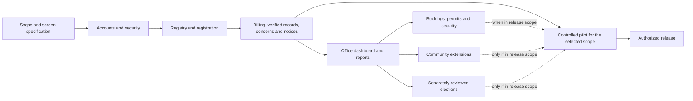

# Master implementation plan

## Current integration delivery - 5 November 2026

Request slice update: `supabase/migrations/202611050001_request_workflow.sql` and its resident/office adapters are prepared locally, not installed. They provide owner-scoped request records, request conversations, office-owned versioned status changes, idempotent submission/replies and transactional audit. Ten embedded PostgreSQL refusal/transaction tests cover this new slice. Five invented scenarios are available in isolated role previews. Legacy operational data is not imported; the rest of the integration map below remains outstanding. The source inventory is information, not executable implementation code or verified live data.

The user now requests implementation across the source feature inventory with mobile-first resident UX and a task-oriented staff workspace. Earlier planning-only statements below are historical. Auth and own-member profile are connected; staff directory/registration reads are implemented against the existing tables. The agent has not executed live database changes. Role/constraint SQL was run by the owner. The reference checkout remains static information only; no source code/configuration/assets/record values are reused.

| Delivery area | Current data path | Remaining integration work |
| --- | --- | --- |
| Accounts and registrations | Auth, own-member lookup; paginated staff `members`/`registrations` reads | Protected create/invite/update/suspend operations; approval + retryable delivery; actual policy tests |
| Household profiles and property | Basic recorded unit on member; synthetic registry/dossier | Verify `portal_data.units`/`household` schemas, ownership links and confidentiality; connect dossier from authorized sources |
| Access and audit | Server-read role assignments drive frontend gates; isolated role previews | Review actual RLS/RPCs, override/department rules and audit writers before privileged writes |
| Requests, complaints, concerns, tickets and messages | Connected synthetic workflows | Model identity/property/participants, append replies transactionally, authorized staff assignment, audit, delivery |
| Announcements, hotlines and notifications | Synthetic publishing and audiences | Protected publisher operations, approved contacts, audience-scoped reads, unread/delivery records |
| Amenities and events | Synthetic booking/calendar | Availability and conflict rules, atomic reservation/decision, cancellation, fees and real updates |
| Visitors, gates, vehicles, permits and incidents | Synthetic queues | Scoped gate reads, validity/entry-exit operations, incident confidentiality and evidence uploads |
| Billing and receipts | Synthetic math/ledger/evidence | Trusted liability, invoice generation, payment verification/allocation, credits/reversals and reconciliation |
| Expenses, budgets and reports | Synthetic proposals/exports | Protected posting/approval, real reconciled aggregates and scoped exports |
| Marketplace, jobs, garage sales, booths and training | Structured synthetic modules/directories | Moderation, participant data, inventory/capacity and approved public contacts |
| Rides and carpools | Synthetic dispatch/interest | Verified assignments, trip transitions, seat contention and minimum necessary driver data |
| Board documents, disclosures and elections | Synthetic documents/proposals; no authoritative vote | Protected versions, audience, eligibility/secrecy rules, server ballots and certified tallies |
| Release and maintenance | Local build/tests, current-session developer checks | Live RLS acceptance, backups/restore, monitoring, mail/files, deployment and device/resident acceptance |

Safe sequencing: inspect existing schema/policies and JSON shapes without resident values; connect identity/property context; complete one resident-to-staff request/reply loop; then publishing, bookings/security, finance and remaining community modules. Shared JSON sections are not automatically safe to download wholesale. Source renderer functions do not establish backend enforcement. Missing contracts/rules must not be filled with assumed official policies, and whole-section JSON upserts must not replace transactional multi-user operations.

UI acceptance: cards on mobile and aligned rows on desktop, visible labels and 48px controls, light/dark themes, keyboard/modal focus, separate pending/error/empty states, accurate count scope, no silent sample fallback and no decorative live badges. Each completed module needs mocked browser checks plus owner-approved live API/RLS checks; UI tests alone cannot certify access.

Date: 4 November 2026. Status: **Planned — for review, not an implementation or release approval.**

**Observed** — The user requested a plan covering all eleven workstreams and more visual, informative screens. The approved mobile and compact desktop designs are the starting point. The existing app remains a synthetic local preview; authentication, production authorization and a backend do not exist yet.

**Unknown** — The boss’s selection of the final system, official HOA policies, production schema and ownership, verified records, scope/budget and release dates. A complete plan can identify these dependencies without pretending they are answered. No completion percentage or delivery date is asserted.

Read alongside [[Screen and interaction plan]], [[Permission planning matrix]], [[Release acceptance]], [[Product questions]] and [[Feature inventory]]. The feature inventory records what exists today; this note describes future work.

## Outcome and boundaries

Deliver a resident service connected to an accountable office workflow: a resident sees a trustworthy state, takes an allowed action, receives a system-confirmed outcome, and can follow its progress. Staff see the matching work item and its history. Every sensitive operation has a server-enforced permission and an appropriate audit record.

Keep React 19, TypeScript, React Router, TanStack Query, shared zod contracts, owned CSS components/tokens and CSS Modules. Use a separate development Supabase project only when authorized. Preserve the current mobile and desktop design baselines; do not replace them with a component-kit template.

Planning and synthetic design previews may proceed within their authorized scope. This planning request does not authorize a live connection, deployment, commit, push, store submission or migration. Do not modify or connect to Kate’s environments. Her HTML is workflow evidence only; do not execute, import or reuse its code.

## Proposed delivery sequence

Each phase gets a bounded specification, design review and acceptance evidence. Phase IDs below are planning IDs, not a claim that the original production milestones are complete. Approve implementation scope before starting a phase; do not build all modules in one uncontrolled pass.

| Phase | Deliverable | Dependency / exit condition |
| --- | --- | --- |
| P0 — Scope and screen specification | Prioritized release scope, screen/state inventory, proposed permissions, approved visual patterns and decision register | Boss confirms direction; unresolved questions have an owner and the phase they block |
| P1 — Accounts and security foundation | Separate authorized dev environment, migrations, login/logout, recovery, sessions, verified role and household access | Synthetic identities only; refusal tests prove isolation and privileged-operation restrictions |
| P2 — Registry and registration | Property/household membership, public registration, office review, atomic approval and retryable invitation delivery | Approved verification rules; no partial or duplicate approval on retries |
| P3 — Core resident/office release candidate | Read-only household statements, office billing, verified payment recording/allocation, resident concerns and office resolution, notices and core office queues | Approved finance/workflow rules; matching resident and office records; reconciliation and audit tests |
| P4 — Office control centre | Real aggregate dashboard, queues, reporting drill-downs, permission administration and protected documents | Aggregates reconcile with their source rows; export scope enforced server-side |
| P5 — Amenities, permits and security | Conflict-safe bookings, visitor/gate workflow, vehicles, incidents and permit/document review | Approved capacities, fees, authority and operational rules; real-device workflow review |
| P6 — Community extensions | Marketplace, training and transport, one module at a time | Moderation, consent, operating rules and responsible staff approved per module |
| P7 — Governance and elections | Approved election process, eligibility, secret-ballot design, server-owned submission/counting and controlled results | Separate threat/design review, approved rules and independent verification before opening an election |
| P8 — Controlled resident pilot | Selected verified households and staff complete supported flows; monitoring and recovery exercised | Acceptance in [[Release acceptance]], including residents aged 60+ on their own phones |
| P9 — Web release and optional native distribution | Authorized hosting/release, support ownership, then separately approved Android/iOS distribution | No unresolved release blockers; signed builds and store review are separate from a working PWA |

P3 is the proposed first useful release candidate, not permission to launch immediately. P8 pilot and P9 release gates apply to every release candidate: they can follow P3 without waiting for P4–P7 when those modules are outside the first release. Repeat the relevant gates for subsequent increments. P3 records verified payments; processing money through GCash/cards/QR requires a separate approved provider integration. P4 can add dashboard depth incrementally once source workflows exist. Do not display empty dashboard metrics as zero while P1–P3 are incomplete.

## 1. Login and accounts

**Planned** — Sign in, sign out, recovery request/reset, invitations, public registration, verification/review, rejection with reason, suspension/restoration and session expiry. Define the differences between an application, an authenticated identity, an active membership and a role grant. An identity alone must not imply resident access.

Screens: sign-in form; recovery confirmation; invite acceptance; registration steps; application status; office review queue and detail; account security/session view. Visually show the current step, the pending decision, required evidence and the next allowed action rather than a long instruction page.

Server work: trusted session verification, active-member lookup, rate/abuse controls, protected invitation/recovery delivery and approved privileged-account authentication controls. Keep local/test mail in development. Approval should atomically create/update approved membership, application state, audit and invitation-outbox item. Sending an email happens separately; failed delivery must be visible and retryable without approving twice.

Acceptance: malformed/expired invites, expired/revoked sessions, repeat approval, email delivery failure, suspension during an active session and recovery without account enumeration. Logout clears user-specific Query state and private in-memory state, ends the session through the responsible system and returns to sign-in. Decide local-device versus all-device logout explicitly.

**Unknown** — Who can approve accounts, acceptable proof, duplicate/rejected applications, invitation validity, reactivation and privileged authentication requirements.

## 2. Roles and permissions

**Planned** — Implement approved capabilities for admin/staff, homeowner, renter, board, security and driver, including extra roles, scoped page overrides and view-only mode. Define the scope of every grant: own profile, household/property, assigned work, association or protected platform administration.

Screens: office role directory; member access detail; grouped permission matrix; proposed-change comparison and reason/reference form; effective-access explanation. Show why access is granted or refused. A permission editor must not quietly let staff grant powers they do not possess.

Server work: protected grants/overrides; approved precedence rules; membership effective dates; enforced view-only behavior; immediate handling of suspensions and access changes. Do not trust browser controls or user-editable profile metadata for authority. See [[Permission planning matrix]].

Acceptance: resident self-escalation refused; direct requests/RPCs refused even when UI is bypassed; no cross-household reads; extra roles and overrides match the approved policy; a suspended or moved-out member loses access as specified.

**Unknown** — Super-admin powers, staff responsibilities, deny/grant precedence, delegated authority and separation of financial verification duties.

## 3. Properties and residents

**Planned** — Verified property registry; owner/tenant/household membership; multiple properties per identity if allowed; vehicles/stickers; occupancy and ownership changes; correction and historical membership handling.

Screens: searchable unit list, phase/status filters, property dossier, linked residents, vehicle list, membership timeline and a guided transfer/review flow. Offer a map only if actual usable geographic data is provided; do not draw a fictional subdivision map.

Data: keep properties, households, identities and effective-dated memberships separate. A past membership must not automatically expose a new household’s records. Financial responsibility and household membership are not interchangeable concepts. Ownership transfers may involve multiple records and need transactional handling.

Acceptance: duplicate units, simultaneous edit conflicts, tenants leaving, owners with multiple properties and attempted access to a property after membership ends. Changes need an authorized actor, evidence where required and retained history.

**Unknown** — Authoritative registry, who is liable for dues, multi-household arrangements, transfer effective dates and access to historical statements.

## 4. Admin overview and reporting

**Planned** — A work-focused control centre, not merely a row of attractive totals. Its first screen should show urgent work and the data needed to act: registrations awaiting review, unresolved/assigned concerns, pending bookings, outstanding invoices and verified receipts. Metrics are permission-scoped and linked to the matching records.

Screens: office overview; finance reporting workspace; household drill-down; review queues; report definition/filter panel; authorized export history. Use summary numbers, a time series where history exists, age distribution, compact queues and exact-value tables. Every chart supports keyboard access and an equivalent textual/table view.

Metric definitions to approve: billed amount, receipts, allocations, outstanding, overdue, credits/unapplied receipts, fully paid and part-paid households, unbilled households, collection-rate denominator, reporting period and cutoff. Show currency, scope, last refresh and exclusions. Calendar history is required before showing a month-to-month trend; do not interpolate missing months.

Acceptance: totals reconcile with invoice/receipt/allocation rows; filters and exports use the same scope; unknown datasets remain unavailable; a restricted staff member cannot obtain hidden data through aggregates or exports. A chart never substitutes for an accounting record.

## 5. Finance

**Planned** — Billing rules and approved assessments, invoice issuance, household statements, verified payment recording, partial allocation, credits/unapplied receipts, reversals/corrections, expenses, attachments, cash/bank reconciliation and reports. Store money exactly in centavos or appropriate SQL numeric, with approved rounding rules.

Resident screens: account summary, invoice breakdown, recorded-payment history, receipt detail and billing concern. Office screens: billing preview/issue, payment verification queue, receipt/allocation detail, correction/reversal, expense review and reconciliation workspace. Mobile uses readable amount/status rows; desktop uses sortable, filterable ledgers with detail panels.

Financial state is derived from source records and approved timing rules, not a resident-editable Paid selector. Keep receipts distinct from their invoice allocations. Overpayments need an explicit credit/unapplied amount; do not silently clamp away money. Reversals preserve history and link the correcting record. Invoice issuance and allocation operations need duplicate protection and concurrency checks.

Processing payments is a separate scope: approved provider, verified destination, server-created payment intents where applicable, verified provider events, idempotency, failed/cancelled/duplicate/out-of-order events, refunds and reconciliation. A browser redirect or uploaded screenshot must never mark an invoice paid by itself. Until connected, show availability honestly.

Acceptance: partial payment, overpayment, duplicated verification, concurrent allocation, reversed receipt, period boundary, missing bill, failed ledger load, reconciliation mismatch and unauthorized mutation. Audit and the financial operation commit together where required. Define who may verify, reverse and approve expenses before building those controls.

## 6. Office operations

**Planned** — Requests, concerns, complaints and document requests with approved categories, ownership/assignment, status transitions, resident updates, attachments, internal notes, escalation and resolution/reopening if allowed.

Screens: resident request list/detail with a progress timeline; office inbox with counts/filter chips; assigned-work view; request detail panel; conversation and resolution summary. Separate resident-visible messages from internal staff notes. A board view must not automatically expose confidential complaint details.

Data: requests, assigned staff, append-only workflow/message events and protected attachment references. Define state transitions and who can perform them; avoid one generic update endpoint that accepts any status.

Acceptance: double assignment, removed assignee, simultaneous replies, upload denial, request withdrawal, confidential complaint access and notification failure after a committed update. Do not promise a response time until the HOA approves one.

## 7. Amenities, permits and security

**Planned** — Build these as distinct workflows sharing approved patterns, not a single universal status form.

| Module | Workflow and visual treatment | Critical dependency / check |
| --- | --- | --- |
| Amenities | Availability calendar/list → request details → review → confirmation/cancellation; booking timeline and fee breakdown | Server-side overlap protection, capacity/hours/fees, pending holds and cancellation policy |
| Visitor/gate passes | Visitor request → approved pass if required → guard lookup/validation → entry/exit events | Verified security role, expiry/revocation, pass validity and minimal disclosure; no pretend QR authority |
| Vehicles/stickers | Vehicle list → evidence submission → review → authorized registration/issuance | Approved ownership checks, fees and sticker validity; no self-approval |
| Incidents | Structured incident report → security handling → authorized escalation/closure | Confidential scope, evidence access and verified emergency procedures; the portal must not imply emergency monitoring it cannot provide |
| Permits/clearances | Choose an approved type → requirements checklist → submission → review → issued document if authorized | Approved permit types, reviewer powers, requirements/fees and document validity |

Acceptance: two users request the same slot; revoked/expired pass presented at a gate; repeat entry scans; guard offline; restricted incident attachments; expired vehicle registration; rejected/resubmitted permit. Offline behavior must be specified with security staff; cached browser state must never become independent gate authority.

## 8. Community management

**Planned** — Announcement drafts/review/publishing, audience targeting, scheduling/expiry if needed, readable notice details, protected board documents, document versions and notifications/preferences. A published board document is an approved file with provenance, not a sample title treated as official.

Screens: announcement feed with category/date/priority; concise editor with audience preview; publication queue; document library with type/date/version/access labels; notification inbox and preferences. Use previews only for safe supported file types. Show full text where the content itself is the notice; do not turn essential information into unexplained icons.

Server work: approved publishing capability, private file policies, authorized version access, short-lived downloads where appropriate, notification outbox, retry/delivery tracking and minimal message content on external channels.

Acceptance: targeted notice leaks, expired/deleted document links, stale versions, unsafe attachment attempts, duplicate delivery and a successfully published notice whose notification delivery failed. Publishing and delivery are different confirmed states.

## 9. Other modules

**Planned** — Marketplace: verified/approved listings, categories, moderation, reporting and consent-aware contact sharing. Visuals: compact listing cards with real permissioned images if supplied, clear verification/availability labels and a detail view. Decide whether it is listings only or transactions; do not imply order/payment support without it.

**Planned** — Training: session catalogue, approved schedule/capacity, enrollment/waitlist/cancellation if allowed, attendance and facilitator view. Visuals: date/time cards, remaining-capacity state only when known, enrollment progress and session roster for authorized staff.

**Planned** — Transport: verified drivers, routes, seats, requests, confirmed trip roster, cancellation and trip progress. Visuals: route/stop diagram and departure/seat rows; maps/tracking only with a justified data source and consent. The driver sees only assigned-trip data needed for the job.

**Planned** — Elections: election rules/configuration, eligibility register, proxy handling if allowed, ballot review/submission confirmation, server-owned tally and controlled publication. Visuals: clear election state, eligibility/checklist, readable ballot and receipt of submission that does not reveal a secret vote. No client tally or shared browser ballot collection. Access controls alone do not establish ballot secrecy; design identity separation and allowed audit evidence explicitly.

Each module needs its own specification, permissions and refusal/failure tests. Their existence in the reference app does not mean all belong in the first release.

## 10. Backend security and data integrity

**Planned** — Versioned migrations; normalized entities with row-level operations; indexes/constraints; household/property membership enforcement; operation-specific RPCs for sensitive transactions; storage policies; server-owned audit and retryable delivery outboxes. Replace the preview repository rather than copying its whole-state storage model into a database.

Audit events must identify trusted actor/action/target/time and an appropriate reason/reference without logging passwords, tokens or unnecessary personal data. Define before/after data retention and who can inspect audit entries. Financial and access changes must not quietly succeed if mandatory audit recording fails.

Use synthetic dev identities and approved fixture datasets. Keep secrets out of source/client bundles/logs. Runtime authorization must be checked even for direct API access. Review multi-role/override behavior, ownership changes, revoked access, file policies, aggregate visibility and export scope. Tests prove negative cases, not only successful logins.

Acceptance: clean-to-current migrations, safe repeat application through the migration tool, planned data transformations, transactional rollback, concurrent edits, idempotent retries and the refusal matrix in [[Release acceptance]]. No RLS security is claimed until an actual database test runs.

## 11. Release operations

**Planned** — Separate environments, documented release configuration, CI checks, protected credentials, error/availability monitoring, recovery and restore exercises, rollback procedure, support ownership and an incident process. Agree recovery targets before claiming they are met. Decide what records need backup, how they are protected and who may restore them.

Run the resident pilot on real mid-range Android phones and iPhones, on realistic networks, with keyboard/screen-reader/zoom checks where applicable. Include 3–5 residents aged 60+ using the supported flows unaided. Review findings and fix blocked tasks before release.

Native remains a separate decision: preserve portable contracts/logic for Expo/React Native, keep native UI separate, and assess packaging approach before implementation. A PWA preview does not equal signed Android/iOS builds or store approval. Publishing accounts, privacy disclosures, supported devices, notifications/deep links, update behavior and signing/review work remain required where applicable.

**Excluded until separately assessed** — Production data migration, GHL integration, changing Kate’s app, production cutover, and native-store submission. Even if this rebuild is selected, these require their own evidence, scope and authorization.

## Work item template

Every implementation slice should carry: user task; current evidence/reference lines; approved and unknown rules; resident/office screens; complete state list; API and entity contracts; effective permissions; transactional/audit/delivery behavior; failure/concurrency cases; measurable acceptance; synthetic test fixtures; and affected vault notes. A visual mockup alone cannot close a production slice.
