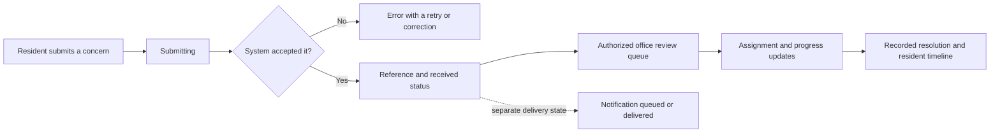

# Screen and interaction plan

Status: **Planned — design specification, not implemented screens or approved HOA policy.**

**Observed** — The user likes the mobile and refined desktop designs and wants more useful visual information across the remaining system. Some current placeholder pages are explanatory text because verified rules/data are missing. The next design pass should create clear information structures and interactive prototypes without inventing official information or backend success.

See [[Design system]], [[Master implementation plan]], [[Permission planning matrix]] and [[Release acceptance]].

## What “more visual and informative” means

Use a visual when it helps a person answer a concrete question: What do I owe? What is waiting? Where is my request? Is this time available? What changed? Which decision needs me? Replace introductory essays with a status summary, exact values/dates and a short next action. Keep detailed rules, history and explanations available through progressive disclosure.

Do not replace readable information with decorative charts, generic card grids, a hero image, oversized numbers everywhere or unexplained icons. A longer notice, resolution, rejection reason or policy document is legitimate content; keep it readable. A chart needs a real data source, definition, reporting period and accessible exact values. Unknown, not issued and failed to load must remain distinct from zero/empty.

## Navigation by job

| Workspace | Proposed structure | Design boundary |
| --- | --- | --- |
| Resident | Keep Home, Account, Updates, Services, More; the approved home service shortcuts remain | No additional top-level destinations for every module; office access appears only with an approved capability once real auth exists |
| Office | Overview, Residents, Finance, Operations, Community; nested administration/settings where authorized | A task-focused workspace with review queues and drill-downs, not the resident home enlarged |
| Security | Gate activity, Pass lookup/visitors, Vehicles, Incidents; own account/help | Prioritize fast lookup, legible validity and entry/exit confirmation; restrict unrelated finance/personal data |
| Driver | Assigned trips, Trip detail/roster, Trip status, own account/help | Minimum necessary passenger data; no access to unrelated household records |
| Board | Approved oversight/governance views within its allowed workspace | Board role does not imply unrestricted finance, complaints, votes or account administration |

**Unknown** — Exact office/board/security/driver grants and context switching. Navigation follows approved effective permissions; it never defines or enforces them by itself. A role/workspace selector is not a way to gain authority.

## Screen blueprint

| Screen / family | Primary visual structure | Useful information and next action |
| --- | --- | --- |
| Sign in / recovery | Compact form; field-level feedback; clear pending/result panel | What credentials are required, recovery state and session outcome; no public account enumeration |
| Invitation / registration | Short multi-step form and evidence checklist | Completed/required steps, safe attachment status, review state and next step |
| Office registration review | Searchable queue, identity/property comparison, evidence viewer and decision panel | Verified/mismatched/unavailable fields, reviewer reason, approval state and invitation delivery state |
| Resident Home | Preserve balance card, recorded-payment strip, service shortcuts, compact updates/activity | Outstanding versus unbilled, due date, latest request/booking and visible next action |
| Office overview | A small number of relevant metrics, action queue, upcoming items, meaningful trend where data exists | Real urgent work, scope/as-of time and drill-through; avoid equal-weight boxes for all 16 modules |
| Resident bills | Amount/date/status rows; invoice detail breakdown; recorded-payment timeline | Charges, receipts/allocations, balance and due date; billing concern; online-pay action only when approved and connected |
| Office billing | Billing-period summary and reviewable itemized issuance preview | Which properties are included/excluded, exact calculation inputs and issuance confirmation |
| Payment verification | Queue beside evidence, receipt/allocation breakdown and review history | Unverified versus verified, proposed allocations, duplicate warnings and confirmed ledger effect |
| Finance reports | Time series when supported, age bars, scoped ledger and reconciliation exceptions | Collection definitions, exact values, excluded/unavailable datasets and drill-down/export |
| Expenses / reconciliation | Filtered ledger, grouped categories where meaningful, matched/unmatched work list | Expense approval, source evidence, unmatched records and balanced/unbalanced state |
| Property directory | Search/filter list on mobile, dense table on desktop; property dossier | Unit, current membership/occupancy, verified contacts where permitted and change history |
| Household transfer | Before/after membership comparison and effective-date timeline | What changes, who loses/gains access and which historical records remain visible |
| Vehicles / stickers | Vehicle rows with verification/expiry state, evidence and review checklist | Actual vehicle, valid/expired/pending status and approved renewal/registration action |
| Requests / concerns | Filter chips and status rows; detail timeline and conversation | Assigned party where permitted, last update, resident-visible next step and resolution |
| Office request inbox | Assigned/unassigned/status queues; list-detail workspace; optional board toggle | Next work item, allowed transitions, private internal notes versus resident messages |
| Amenities | Calendar with a list alternative; availability legend and time choices | Actual slot state, capacity/fees when known, pending versus confirmed reservation and cancellation policy |
| Visitor pass / guard view | Request details and validity panel; pass/scan view only when real authority exists | Visitor, property, allowed time, revoked/expired/valid state and confirmed entry/exit event |
| Incidents | Structured incident list, location/time/severity labels and evidence timeline | Authorized response state and escalation; never imply an unstaffed emergency service |
| Permits / clearances | Approved type selector, requirements checklist and review timeline | Missing evidence, fees when approved, decision reasons and issued-document validity |
| Announcements | Compact priority/date feed; readable notice; editor audience preview | What changed, when it applies, who receives it and publication versus notification state |
| Documents | Filtered library with file type/date/version/access labels | Approved title, provenance/version, accessible preview/download and permission-aware unavailable state |
| Marketplace | Listing cards with permissioned images if supplied; filter/detail views | Actual offer, price/availability when supplied, verification/moderation state and allowed contact action |
| Training | Session/date cards, enrollment state and staff roster | Schedule, location/capacity when confirmed and enrollment/waitlist/cancellation outcome |
| Transport | Departure/seat rows and route-stop diagram; assigned-trip detail | Verified driver, pickup/departure, fare if approved and confirmed seat/trip state |
| Elections | Election status, eligibility checklist, readable ballot/review and submission outcome | Approved schedule, eligibility and whether submission was accepted; never a fabricated or browser-owned tally |
| Access management | Grouped capability matrix, effective-access summary and change comparison | Scope, source of permission, view-only effect and confirmation with reason/reference |
| Audit | Searchable chronological events, actor/target/reason and constrained change comparison | Trusted event provenance and authorized detail; local preview history must not be presented as secure audit |
| Profile / account security | Household summary, contact form, verified/unverified labels and session list if supported | Which fields may change, verification required and sign-out outcome |
| Notifications / help | Grouped unread/action states, preferences and concise task-based help | Delivery/inbox state, next action and verified contacts; missing official contacts stay unavailable |

## Shared visual components to design

The resident and office screens must describe the same underlying workflow. For example, a request should progress visibly without suggesting a decision that has not happened:

The statuses and transitions in this illustration are proposed workflow concepts; final names, responsibilities and reopening rules need approval. A received request is not a resolved concern, and a queued notification is not a delivered message.

Build these within the owned component system, not an external kit. Reuse existing Button, Badge, Row, Field, Modal, Feedback, Skeleton and Empty where they fit.

| Proposed component | Reuse across |
| --- | --- |
| Metric with source/scope/date and unavailable state | Office overview, reports, billing and operations |
| Review queue + filter bar + list/detail panel | Registrations, receipts, permits, concerns and moderation |
| Status timeline / change history | Requests, registration, permits, bookings and membership changes |
| Requirements checklist / stepper | Registration, permits, vehicle verification and evidence collection |
| Exact-value chart + table alternative | Collections, aging, approved operational trends |
| Availability calendar + list alternative | Amenities, sessions and schedules |
| Money breakdown / allocation rows | Statements, billing previews, verification and reversals |
| Safe file row / upload progress / authorized preview | Proof, receipts, documents and incident attachments |
| Permission summary / change comparison | Role grants, overrides and high-impact review actions |
| Empty/error/unavailable panel with relevant next action | Every module; shape it like the real content rather than a paragraph-only placeholder |

Status names and state transitions must come from approved workflow definitions. Shared badge styles do not justify giving every module the same state machine.

## Responsive and interaction contract

Preserve the approved blue/neutral identity, Manrope, semantic light/dark tokens, spacing/type scales and restrained surfaces. Use colour for actions/status, labels alongside icons, tabular money and consistent date presentation. Body text remains 16px or greater; secondary text at least 14px; controls at least 48×48px. Use one icon stroke system and the established 20px inline/24px navigation patterns.

Mobile: prioritize current status and one primary action; use readable rows and small steps, bottom sheets for bounded forms, full screens for long workflows and a keyboard-visible submit area. Desktop: use useful columns, aligned ledgers and review panels with a controlled reading width. Do not stretch mobile tiles across an entire monitor. Collapse columns before labels/controls become cramped. Short viewports and browser zoom must keep all navigation reachable.

Every interactive control needs visible focus and immediate press feedback. An asynchronous action shows pending/disabled state and an actual confirmed result or actionable failure. Modal/sheet behavior includes a name, contained focus, Escape/close route and restored trigger focus. A chart, calendar, attachment action or drag interaction needs a keyboard alternative. Honour reduced motion.

## Required states before a screen is accepted

For each applicable screen, specify: initial loading, populated, empty, unknown/unavailable, failed load, offline/stale, permission refused, session expired, invalid input, submitting/uploading, confirmed outcome, failed save, duplicate/retry and concurrent-change conflict. Add workflow-specific states such as unbilled/part-paid/reversed, pending/confirmed/cancelled booking, expired/revoked pass and failed invitation delivery.

Plan sample fixtures for the states; label them synthetic. Do not use an animated success message to stand in for backend confirmation. Do not fill missing chart data, amounts, approval dates, file names or contact details with plausible-looking values.

## Proposed visual delivery order

1. Create low-detail screen/state maps for all workspaces and confirm navigation.
2. Design the shared queue, timeline, checklist, ledger and unavailable-state patterns.
3. Produce visual resident/office pairs for account access, registration, billing/payment recording and concerns. These are proposed next previews; no application work is authorized by this document alone.
4. Review the admin overview using the same underlying synthetic source records as its drill-downs, so the visual story reconciles.
5. Extend the patterns to bookings/security, documents/community and the optional modules.
6. Review 360px and compact/wide desktop layouts in both themes, then validate tasks with actual residents/staff before claiming usability.

Design review should answer: Can a person find their status without opening several screens? Does every number have a meaning/source? Is the next action clear? Can an older resident complete it without explaining the icons? Does the office see the corresponding work? What happens when the server refuses or fails?
